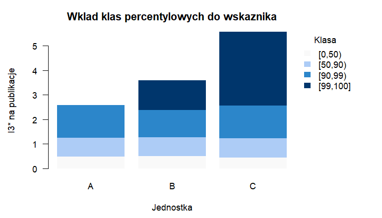

<!-- README.md powstaje z README.Rmd. Zmiany wprowadza się w README.Rmd,
a następnie renderuje plik poleceniem devtools::build_readme(). -->

# WskaznikI3R

[](https://github.com/milakasz08/WskaznikI3R/actions/workflows/R-CMD-check.yaml)

Pakiet języka R do nieparametrycznej oceny oddziaływania publikacji
wskaźnikiem Integrated Impact Indicator w wariancie I3\* (Leydesdorff,
Bornmann i Adams, 2019). Każda publikacja zostaje przypisana do klas
percentylowych ustalonego zbioru odniesienia, a wskaźnik jednostki jest
sumą wag tych klas. Pakiet zwraca wynik surowy, który rośnie z
wielkością dorobku, wynik na jedną publikację, liczności klas oraz ślad
dopasowania każdej publikacji do zbioru odniesienia.

Projekt dyplomowy na kierunku elektroniczne przetwarzanie informacji,
Instytut Studiów Informacyjnych Uniwersytetu Jagiellońskiego. Promotor:
dr Marek Deja.

## Problem badawczy

Rozkład liczby cytowań jest silnie skośny: większość publikacji ma kilka
cytowań albo żadnego, a nieliczne publikacje zbierają ich setki. Średnia
liczba cytowań, na której opiera się współczynnik wpływu czasopisma,
poprawnie opisuje przeciętną wartość, lecz przy skośnym rozkładzie
zależy od kilku publikacji z ogona. Dwa czasopisma o tej samej średniej
mogą mieć różny udział publikacji wysoko cytowanych i różną wielkość
dorobku.

Wskaźnik I3\* zastępuje liczbę cytowań położeniem publikacji w
rozkładzie zbioru odniesienia, czyli publikacji z tej samej dziedziny, z
tego samego rocznika i tego samego typu. Klasa percentylowa niesie wagę,
a suma wag opisuje dorobek jednostki. Wynik surowy odpowiada na pytanie
o łączne oddziaływanie dorobku, a wynik na publikację na pytanie o
przeciętne położenie publikacji. Wybór skali wynika z pytania
badawczego.

Pakiet służy do sprawdzenia, jak wielkość dorobku, reguła rozstrzygania
remisów i dobór zbioru odniesienia zmieniają porównanie jednostek. Wagi
klas pozostają decyzją badacza i są jawnym parametrem obliczenia.

## Metoda

**Klasy i wagi.** Granice $0 = \pi_0 < \pi_1 < \ldots < \pi_J = 100$
dzielą skalę percentylową na $J$ rozłącznych klas. Domyślny schemat I3\*
stosuje klasy dolnych 50%, kolejnych 40%, kolejnych 9% i górnego 1%, z
wagami $w = (1, 2, 10, 100)$.

**Wskaźnik.** Dla jednostki o licznościach klas $n_1, \ldots, n_J$

$$
I3^* = \sum_{j=1}^{J} w_j n_j, \qquad
\frac{I3^*}{N} = \sum_{j=1}^{J} w_j \frac{n_j}{N}, \qquad
N = \sum_{j=1}^{J} n_j .
$$

Pierwsza wielkość sumuje wagi wszystkich publikacji jednostki i rośnie
wraz z liczbą publikacji. Druga jest średnią wagą jednej publikacji.
Liczności klas mogą być ułamkowe, ponieważ publikacja z bloku remisowego
może należeć do kilku klas jednocześnie. Schemat z wagami $(0, 1)$ i
granicami $(0, 90, 100)$ daje liczbę publikacji w górnych 10%, a wynik
na publikację daje ich udział.

**Reguła ułamkowa.** Zbiór odniesienia liczy $M$ publikacji. Publikacja
z liczbą cytowań $c$ należy do bloku $g$ publikacji o tej samej liczbie
cytowań, poniżej którego leży $b$ publikacji o mniejszej liczbie
cytowań. Blok zajmuje przedział percentylowy

$$
\left[P_d, P_g\right] =
\left[\frac{100\, b}{M}, \frac{100\, (b + g)}{M}\right],
$$

a udział publikacji w klasie $j$ wynosi

$$
s_j = \frac{\left|\left[P_d, P_g\right] \cap
\left[\pi_{j-1}, \pi_j\right]\right|}{P_g - P_d}.
$$

Wzór dzieli blok remisowy między klasy proporcjonalnie do części skali
percentylowej, którą blok zajmuje w każdej klasie (Waltman i Schreiber,
2013). Udziały publikacji sumują się do jedności. Publikacja z liczbą
cytowań nieobecną w zbiorze odniesienia otrzymuje pozycję
$P = 100\, b / M$ i cały udział w klasie zawierającej $P$; klasy są
domknięte z lewej strony, a ostatnia także z prawej. Blok publikacji
niecytowanych jest zwykłym blokiem remisowym i może sięgać klas wyższych
niż dolna.

**Reguła progowa.** Wariant dyskretny wyznacza dla dolnej granicy klasy
$\pi_j$ próg cytowań

$$
t_j = c_{(k_j)}, \qquad k_j = \left\lceil \frac{(100 - \pi_j)\, M}{100}
\right\rceil,
$$

gdzie $c_{(k)}$ jest liczbą cytowań publikacji na pozycji $k$ w porządku
malejącym. Publikacja trafia do najwyższej klasy $j$, dla której
$c \ge t_j$. Cały blok remisowy na progu przechodzi do klasy wyższej,
więc liczności klas odbiegają od nominalnych udziałów. Regułę progową
stosują Leydesdorff, Bornmann i Adams (2019) przy wartościach I3\*
czasopism; pakiet udostępnia ją jako analizę wrażliwości.

**Obliczenie.** Sortowanie zbioru odniesienia kosztuje $O(M \log M)$,
dopasowanie $N$ publikacji przez wyszukiwanie binarne $O(N \log M)$, a
agregacja $O(NJ)$. Zbiór odniesienia może składać się z kilku przekrojów
(np. dziedzina i rocznik); bloki i progi są wtedy wyznaczane osobno w
każdym przekroju.

## Procedura generowania danych

Funkcja `generuj_cytowania()` tworzy zbiór odniesienia i trzy jednostki
o znanym mechanizmie powstawania cytowań. Liczba cytowań publikacji jest
mieszaniną zer strukturalnych i rozkładu Poissona o intensywności
log-normalnej:

$$
Z \sim \operatorname{Bernoulli}(0{,}3), \qquad
\log \lambda \sim N\!\left(1;\ 1{,}5^2\right), \qquad
C =
\begin{cases}
0, & Z = 1,\\
\operatorname{Poisson}(\lambda), & Z = 0.
\end{cases}
$$

Rozkład Poissona przy małej intensywności dodaje własne zera, więc
udział publikacji niecytowanych wynosi

$$
P(C = 0) = 0{,}3 + 0{,}7\, \operatorname{E}\!\left[e^{-\lambda}\right]
\approx 0{,}448,
$$

czyli więcej niż udział zer strukturalnych równy 0,3. Zbiór odniesienia
liczy 5000 publikacji. Jednostki A (100 publikacji) i B (1000
publikacji) pochodzą z tego samego rozkładu i różnią się tylko
wielkością. Jednostka C liczy 100 publikacji; pierwsze pięć z nich ma
intensywność pomnożoną przez 50 i nie podlega zerom strukturalnym.
Wariant z zaokrągleniem cytowań do wielokrotności 5 zwiększa liczbę
remisów. Ziarno 202709 i kolejność losowania (odniesienie, A, B, C; w
każdej grupie wskaźniki zer, intensywności, liczby cytowań) są ustalone.

Prawdą konstrukcyjną są udziały w klasach i sumy ważone przy ustalonym
odniesieniu. Zbiór odniesienia przypisany do samego siebie regułą
ułamkową daje dokładnie nominalne liczności klas (50%, 40%, 9% i 1%
$M$), więc
$I3^*/M = 0{,}5 \cdot 1 + 0{,}4 \cdot 2 + 0{,}09 \cdot 10 + 0{,}01
\cdot 100 = 3{,}2$ dla każdego zbioru odniesienia. Procedura nie
wyznacza jednego poprawnego uporządkowania jednostek, ponieważ wynik
surowy i wynik na publikację odpowiadają na różne pytania.

Charakterystyka zbioru odniesienia z danych przykładowych:

``` r
library(WskaznikI3R)

cytowania <- odniesienie_przyklad$cytowania
c(niecytowane = mean(cytowania == 0), srednia = mean(cytowania),
  mediana = median(cytowania))
#> niecytowane     srednia     mediana 
#>      0.4500      5.4978      1.0000
quantile(cytowania, c(0.9, 0.99, 0.999))
#>     90%     99%   99.9% 
#>  13.000  73.000 187.004
# udzial cytowan skupionych w 10% najczesciej cytowanych publikacji
sum(sort(cytowania, decreasing = TRUE)[1:500]) / sum(cytowania)
#> [1] 0.6581542
```

## Instalacja

``` r
# install.packages("remotes")
remotes::install_github("milakasz08/WskaznikI3R")
```

## Przykład

Zbiór odniesienia i przypisanie publikacji trzech jednostek do klas:

``` r
odniesienie <- przygotuj_odniesienie(odniesienie_przyklad)
odniesienie
#> Zbior odniesienia I3*
#>   granice klas: 0, 50, 90, 99, 100
#>   przekroj calosc: 5000 publikacji, 105 blokow remisowych, najwiekszy blok 2250 (cytowania = 0)

udzialy <- przypisz_klasy(jednostki_przyklad, odniesienie)
wynik <- oblicz_i3(udzialy, jednostki_przyklad$jednostka)
wynik
#> Wskaznik I3*
#>   wagi klas: 1, 2, 10, 100
#>   regula remisow: ulamkowe
#> 
#>  jednostka    N       I3 I3_na_publikacje       status
#>          A  100  258.421            2.584 zdefiniowany
#>          B 1000 3584.740            3.585 zdefiniowany
#>          C  100  556.957            5.570 zdefiniowany
```

Wynik surowy jednostki B jest największy, ponieważ jednostka B ma
dziesięciokrotnie więcej publikacji. Wynik na publikację jest najwyższy
w jednostce C, w której pięć publikacji leży w górnych klasach.

``` r
plot(wynik, skala = "na_publikacje")
```



Reguła progowa jako analiza wrażliwości:

``` r
oblicz_i3(przypisz_klasy(jednostki_przyklad, odniesienie,
                         remisy = "dyskretne"),
          jednostki_przyklad$jednostka)$wyniki
#>   jednostka    N   I3 I3_na_publikacje       status
#> 1         A  100  268            2.680 zdefiniowany
#> 2         B 1000 3681            3.681 zdefiniowany
#> 3         C  100  567            5.670 zdefiniowany
```

Liczba i udział publikacji w górnych 10%:

``` r
odniesienie_10 <- przygotuj_odniesienie(odniesienie_przyklad,
                                        progi = c(0, 90, 100))
oblicz_i3(przypisz_klasy(jednostki_przyklad, odniesienie_10),
          jednostki_przyklad$jednostka, wagi = c(0, 1))$wyniki
#>   jednostka    N        I3 I3_na_publikacje       status
#> 1         A  100  13.38235        0.1338235 zdefiniowany
#> 2         B 1000 124.82353        0.1248235 zdefiniowany
#> 3         C  100  16.38235        0.1638235 zdefiniowany
```

## Struktura pakietu

| Plik | Zawartość |
|----|----|
| `R/odniesienie.R` | `przygotuj_odniesienie()`: bloki remisowe, progi reguły dyskretnej, przekroje |
| `R/percentyle.R` | `przypisz_klasy()`: udziały w klasach według reguły ułamkowej albo progowej, ślad dopasowania |
| `R/i3.R` | `oblicz_i3()`: wynik surowy, wynik na publikację, liczności klas |
| `R/generator.R` | `generuj_cytowania()` |
| `R/metody_s3.R` | metody `print()`, `summary()` i `plot()` klasy `wynik_i3` oraz wydruki obiektów pośrednich |
| `R/dane.R` | dokumentacja zbiorów `odniesienie_przyklad` i `jednostki_przyklad` |
| `data-raw/generuj_dane.R` | skrypt tworzący zbiory przykładowe |
| `tests/testthat/` | testy analityczne, testy własności, procedura generowania, kontrakt błędów |
| `vignettes/` | poradnik oraz strony serwisu: algorytm i nota o serwisie |

## Weryfikacja

Testy pakietu mają trzy warstwy. **Przypadki analityczne** porównują
wynik z wartościami policzonymi ręcznie, z rachunkiem zapisanym w
komentarzu testu: po jednej publikacji w każdej klasie daje $I3^* = 113$
i wynik na publikację 28,25; trzy publikacje w górnych 10% na dziesięć
dają liczbę 3 i udział 0,3; blok dziesięciu remisowych publikacji
zajmujący percentyle 80–100 daje udziały 0,5, 0,45 i 0,05, wkład 10,5 na
publikację i 105 dla bloku, a przy regule progowej 1000. **Testy
własności** sprawdzają warunki niezależne od danych: zgodność z
niezależnym obliczeniem udziałów, sumę udziałów równą 1, nominalne
liczności klas i $I3^*/M = 3{,}2$ dla zbioru odniesienia przypisanego do
samego siebie, ograniczenie $N \min w \le I3^* \le N \max w$,
addytywność wyniku surowego dla rozłącznych jednostek i niezależność od
kolejności publikacji. **Testy procedury generowania** sprawdzają
powtarzalność, udział publikacji niecytowanych względem wartości
teoretycznej i położenie publikacji wzmocnionych.

Testy kontraktu błędów opisują reakcję na dane spoza dziedziny metody:
ujemne lub ułamkowe cytowania, niepoprawne granice klas, niezgodną
liczbę wag i brak zbioru odniesienia.

``` r
devtools::test()
devtools::check()
```

## Literatura

Leydesdorff, L., Bornmann, L., Adams, J. (2019). The Integrated Impact
Indicator revisited (I3\*): A non-parametric alternative to the journal
impact factor. *Scientometrics*, 119, 1669–1694.
<https://doi.org/10.1007/s11192-019-03099-8>

Waltman, L., Schreiber, M. (2013). On the calculation of
percentile-based bibliometric indicators. *Journal of the American
Society for Information Science and Technology*, 64(2), 372–379.
<https://doi.org/10.1002/asi.22775>

## Licencja

GPL-3.
